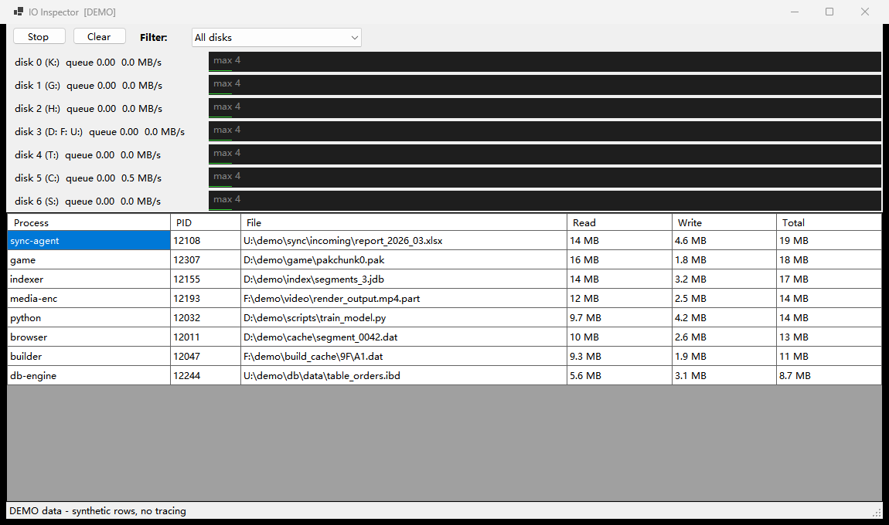

# IO Inspector

**English** | [中文](README.zh-CN.md)

A Windows disk-queue monitor that answers the question Resource Monitor leaves half-open:
*the queue is exploding — which process, and which file, is doing it right now?*



## Features

- **Per-physical-disk queue length** with resmon-style live sparklines (PDH performance counters — the same numbers Resource Monitor shows, locale-proof via English PDH paths).
- **Per-file attribution**: PID, process name, file path, read/write bytes — from ETW kernel FileIO tracing (the same data source Resource Monitor uses).
- **Cumulative capture**: rows accumulate per (process, file) from **Start** to **Stop** — stable, sortable, analyzable. **Clear** resets charts and table.
- **Filter** by physical disk or drive letter; table re-renders instantly.
- **Sortable columns**: click a header to sort, click again to reverse (arrow shows direction).
- **Right-click a row**: *Detail* shows full process info (exe path, command line, parent, user, memory, threads…); *Terminate* kills the process tree (with confirmation).
- **Stateless CLI** for scripts and AI agents: one command, one capture window, one summary.
- **Self-elevating**: GUI asks for UAC at start (ETW needs admin); counters work without it.

## Build / Run / Test

Requires Windows 10+ and the [.NET 9 SDK](https://dotnet.microsoft.com/download) to build
(only the .NET 9 Desktop Runtime is needed to run a built exe).

```bat
build.bat        rem -> bin\IoInspector.exe
run.bat          rem GUI (self-elevates via UAC)
test.bat         rem build + selftest + CLI smoke
```

## CLI usage

```
IoInspector.exe --cli [--disk D:|3] [--top N] [--timeout N] [--sort KEY] [--asc] [--log FILE]
IoInspector.exe --detail PID     rem full process info dump, then exit
IoInspector.exe --kill PID       rem terminate process tree, then exit (no prompt)
IoInspector.exe --demo           rem GUI with synthetic data (privacy-safe screenshots)
IoInspector.exe --selftest
```

- `--timeout N` (alias `--seconds`): capture exactly N seconds, print a cumulative
  top-N summary (sorted by `--sort total|read|write|process|pid|file`), exit.
  This is the AI/agent-friendly mode: fully deterministic one-shot output.
- Without admin rights the CLI still reports per-disk queue/throughput; file
  attribution is skipped with a warning.

Example — watch the HDD that hosts D:, F: and U: for 30 seconds:

```bat
IoInspector.exe --cli --disk 3 --timeout 30 --sort write
```

## How it works

- Queue length / throughput: `PdhAddEnglishCounter("\PhysicalDisk(*)\Current Disk Queue Length")` etc.
  Instance names (`3 d: f: u:`) double as the physical-disk ↔ drive-letter map.
- File attribution: `Microsoft.Diagnostics.Tracing.TraceEvent` opens a kernel session
  (`DiskFileIO | FileIO | FileIOInit | Process` keywords); `\Device\HarddiskVolumeN`
  paths are translated to drive letters via `QueryDosDevice`.
- Process names are resolved at event time (a short-lived process is long gone by
  render time — resolving late is how you get useless "pid 1234" rows).

## Notes

- Only one kernel ETW session can trace at a time; close other tracers if start fails.
- The screenshot above uses `--demo` synthetic data, so no real file paths appear.
