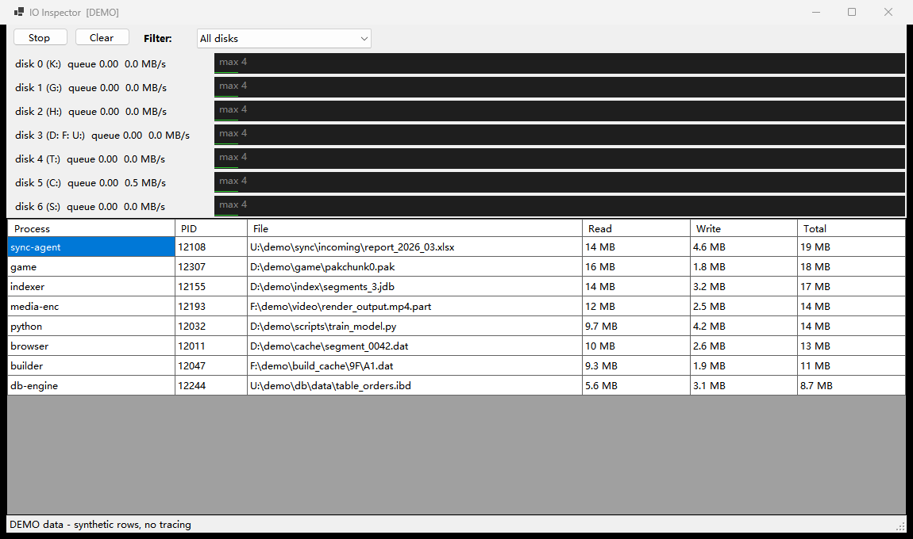

# IO Inspector

[English](README.md) | **中文**

Windows 磁盘队列监视器。回答资源监视器答了一半的问题:
*队列爆了——到底是哪个进程、哪个文件在读写?*



## 功能

- **每个物理磁盘的队列长度**,带资源监视器风格的实时迷你图(基于 PDH 性能计数器,
  与资源监视器同源;使用英文 PDH 路径,不受系统语言影响)。
- **逐文件归因**:PID、进程名、文件路径、读/写字节数——来自 ETW 内核 FileIO 跟踪
  (与资源监视器相同的数据源)。
- **累积捕获**:从 **Start** 到 **Stop**,表格按 (进程, 文件) 持续累积——数据稳定、
  可排序、可分析。**Clear** 清空图表与表格。
- **过滤器**:按物理磁盘或盘符过滤,表格即时刷新。
- **列排序**:点击表头排序,再次点击反向(箭头指示方向)。
- **右键菜单**:*Detail* 弹出完整进程信息(exe 路径、命令行、父进程、用户、内存、
  线程数等);*Terminate* 结束整个进程树(有确认框)。
- **无状态 CLI**,适合脚本与 AI 调用:一条命令、一个捕获窗口、一份汇总。
- **自动提权**:GUI 启动时弹 UAC(ETW 需要管理员);仅看计数器无需提权。

## 构建 / 运行 / 测试

需要 Windows 10+ 与 [.NET 9 SDK](https://dotnet.microsoft.com/download)
(运行已编译的 exe 只需 .NET 9 桌面运行时)。

```bat
build.bat        rem -> bin\IoInspector.exe
run.bat          rem GUI(自动 UAC 提权)
test.bat         rem 构建 + 自检 + CLI 冒烟测试
```

## CLI 用法

```
IoInspector.exe --cli [--disk D:|3] [--top N] [--timeout N] [--sort KEY] [--asc] [--log FILE]
IoInspector.exe --detail PID     rem 打印完整进程信息后退出
IoInspector.exe --kill PID       rem 结束进程树后退出(无确认提示)
IoInspector.exe --demo           rem 使用合成数据的 GUI(截图安全)
IoInspector.exe --selftest
```

- `--timeout N`(同 `--seconds`):捕获 N 秒后打印累积 Top-N 汇总
  (按 `--sort total|read|write|process|pid|file` 排序)并退出,
  适合 AI/脚本调用的确定性一次性输出。
- 无管理员权限时 CLI 仍输出各磁盘队列/吞吐,文件归因跳过并给出警告。

示例——监视承载 D:、F:、U: 的那块机械硬盘 30 秒:

```bat
IoInspector.exe --cli --disk 3 --timeout 30 --sort write
```

## 实现原理

- 队列长度/吞吐:`PdhAddEnglishCounter("\PhysicalDisk(*)\Current Disk Queue Length")` 等;
  实例名(如 `3 d: f: u:`)同时充当物理磁盘 ↔ 盘符映射。
- 文件归因:`Microsoft.Diagnostics.Tracing.TraceEvent` 开启内核会话
  (`DiskFileIO | FileIO | FileIOInit | Process`);`\Device\HarddiskVolumeN`
  路径经 `QueryDosDevice` 翻译成盘符路径。
- 进程名在**事件发生时**解析(短命进程到渲染时早已退出——解析太晚就是一堆
  无用的 "pid 1234" 行)。

## 说明

- 内核 ETW 会话同一时刻只能有一个;若启动失败请先关闭其他跟踪工具。
- 上方截图使用 `--demo` 合成数据,不含任何真实文件路径。
